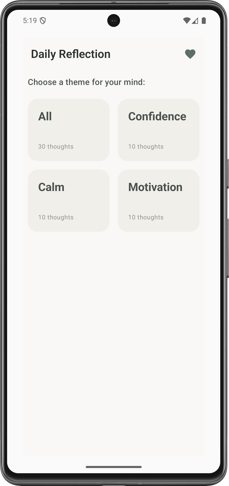
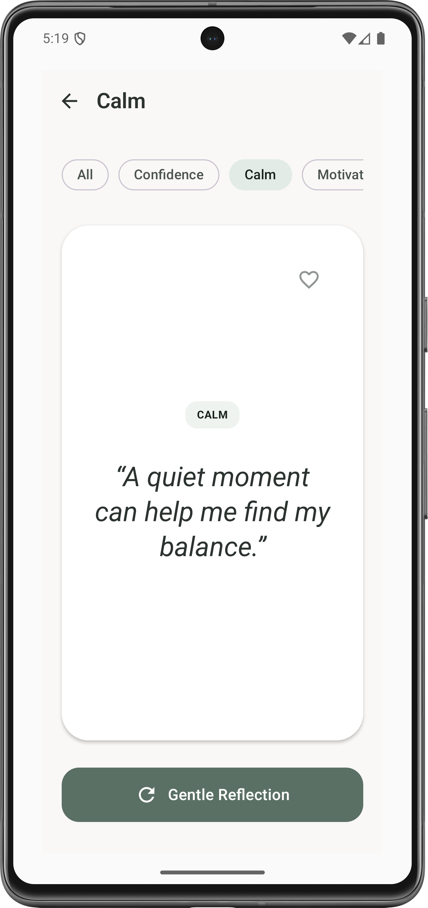
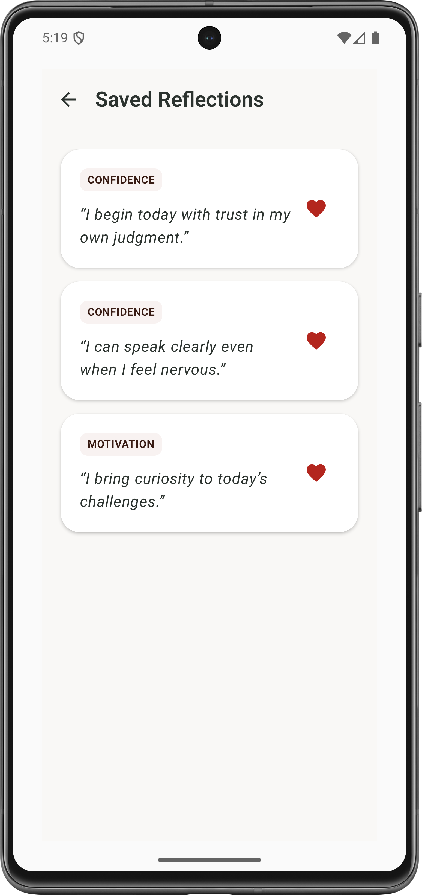

# Affirmations App

A simple, calming affirmations app built with **Compose Multiplatform** for Android and iOS. Choose a topic, discover a random affirmation, and save your favorites for later.

## Screenshots

### Android

  
  
  

### iOS

  
  
  

## Features

- **Topic selection:** Choose from Confidence, Calm, and Motivation.
- **Random affirmations:** Discover an affirmation from your selected topic.
- **Quick topic switching:** Switch topics using the filters at the top of the affirmation screen.
- **Favorites:** Save and unsave affirmations.
- **Local persistence:** Store affirmation data and favorite status locally using Room.
- **Cross-platform UI:** Share UI and application logic between Android and iOS.
- **Offline-first:** No backend or network connection is required for the core experience.

## Tech Stack

- **Language:** Kotlin
- **UI:** Compose Multiplatform
- **Database:** Room
- **Data source:** Local JSON asset
- **Architecture:** Shared UI and business logic with platform-specific entry points

## Getting Started

### Run on Android

1. Clone the repository.
2. Open the project in Android Studio.
3. Allow Gradle synchronization to finish.
4. Select the Android run configuration.
5. Run the app on an emulator or physical device.

### Run on iOS

1. Open the project in Android Studio and synchronize Gradle.
2. Open the generated or configured iOS project in Xcode, typically under `iosApp/`.
3. Select an iOS simulator or connected device.
4. Build and run the iOS app.

> Exact commands and run configurations depend on the Compose Multiplatform project template used.

## How It Works

1. The app loads the affirmation dataset from a local JSON resource.
2. The data is inserted into Room when the database needs initial population.
3. The user selects a topic on the home screen.
4. A random affirmation from that topic is displayed.
5. The user can switch topics, request another affirmation, or toggle its favorite status.
6. Favorite status is stored locally and retained between app launches.

Built with ❤️ using Kotlin and Compose Multiplatform.